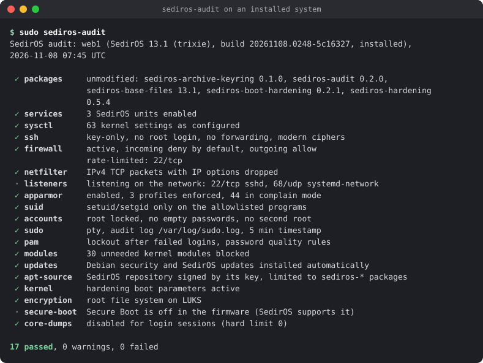
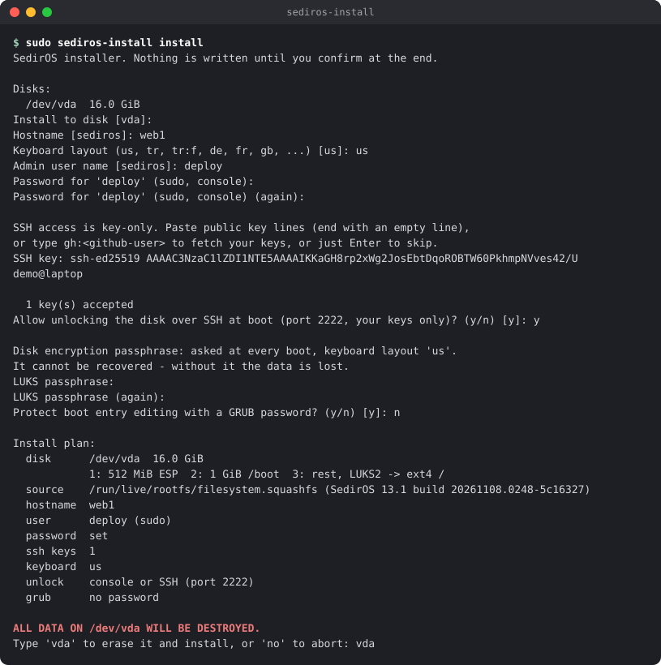
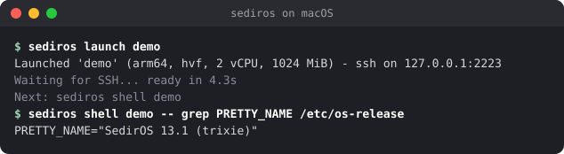

<h1>
  <picture>
    <source media="(prefers-color-scheme: dark)" srcset="docs/images/logo-dark.svg">
    
  </picture>
</h1>

SedirOS is a minimal, hardened Linux distribution. SedirOS 1 is based on Debian 13 (trixie). It is Debian underneath: the same packages, the same security updates, the same `apt`. On top of that it adds a set of security defaults, an installer with disk encryption, and `sediros`, a small CLI that boots SedirOS VMs in seconds.

> **Status:** SedirOS 1.1 is the current release. Get it from the [download page](https://sediros.github.io/sediros/).

## What you get

- **Hardened by default:** kernel and network hardening (sysctl), AppArmor, a firewall that denies incoming traffic, key-only SSH with modern cryptography, no unnecessary SUID programs, automatic Debian security updates.
- **Checkable:** `sudo sediros-audit` tells you whether that hardening is still in place, and which file changed it if not.
- **Encrypted installs:** the installer sets up full disk encryption (LUKS2) and can let you unlock the disk over SSH at boot, for servers you cannot reach physically.
- **Plain Debian underneath:** SedirOS adds a few packages to Debian; it does not replace it. Your Debian knowledge, documentation and packages apply.
- **Fast throwaway VMs:** `sediros launch` starts a SedirOS VM on macOS (Apple Silicon) or Linux in a few seconds.



## Two ways to use SedirOS

| I want to... | Use | Start here |
|---|---|---|
| run SedirOS as the operating system of a server, PC or cloud VM | the installer ISO | [Installing to disk](#installing-to-disk) |
| try SedirOS, or get fast throwaway Linux VMs on my Mac or Linux machine | the `sediros` CLI | [Trying SedirOS in a VM](#trying-sediros-in-a-vm) |

The two are independent: an installed system does not need the CLI, and the CLI never installs anything to disk.

## Getting SedirOS

**Download page: <https://sediros.github.io/sediros/>**: the newest installer ISOs with their checksums, nothing else. Which one:

| Your machine | ISO |
|---|---|
| PC or server with Intel/AMD, or a VM on one (VirtualBox, VMware, Proxmox, Hyper-V, QEMU/KVM) | `sediros-1.1-install-amd64.iso` |
| Mac with Apple Silicon (VM in UTM, Parallels, VMware Fusion), or an ARM server | `sediros-1.1-install-arm64.iso` |

Every release is also mirrored on SourceForge: <https://sourceforge.net/projects/sediros/files/>. Use it when GitHub's downloads are slow or fail; check the file against `SHA256SUMS` either way.

For the `sediros` CLI you download nothing by hand: see [Trying SedirOS in a VM](#trying-sediros-in-a-vm).

<details>
<summary>All release files, and verifying them</summary>

Everything is published on the [GitHub releases page](https://github.com/sediros/sediros/releases). Each release has, for `amd64` and `arm64`:

| File | What it is |
|---|---|
| `sediros-1.1-install-<arch>.iso` | live system and installer |
| `sediros-1.1-<arch>.qcow2` + kernel files | VM image, downloaded by `sediros pull` |
| `sediros-<version>-<platform>.tar.gz` | the `sediros` CLI for macOS and Linux |
| `sediros-*.deb` | SedirOS's packages (also in the [apt repository](https://sediros.github.io/sediros/apt/)) |
| `SHA256SUMS` | checksums of all files |

**Verify what you downloaded** before using it:

```bash
sha256sum -c SHA256SUMS --ignore-missing          # Linux
shasum -a 256 -c SHA256SUMS --ignore-missing      # macOS
```

To also check that a file was built by this repository's release workflow (needs the GitHub CLI):

```bash
gh attestation verify sediros-1.1-install-amd64.iso --repo sediros/sediros
```

</details>

## Installing to disk

### Quick steps

1. **Download** the ISO for your machine from the [download page](https://sediros.github.io/sediros/).
2. **Boot it:**
   - PC or server: write it to a USB stick ([how](#writing-the-usb-stick)) and boot from the stick in **UEFI** mode.
   - VM: attach it as a CD/DVD, with **UEFI** firmware and the guest type **Linux** ([details](#installing-in-a-virtual-machine)).
3. **Install:** in the live session that opens, run `sudo sediros-install install` and answer the questions ([what it asks](#the-installers-questions)).
4. **Power off and remove the ISO** or the USB stick. In a VM, clear the CD/DVD drive *while the VM is off*.
5. **Boot from the disk:** enter the disk encryption passphrase, then log in with your user and password.
6. **SSH:** if you gave an SSH key, log in with `ssh <user>@<address>`. If not, run `sudo sediros-ssh-enroll` on the console and follow it ([details](#logging-in)).

### Requirements

- A 64-bit PC or server (amd64) or ARM machine (arm64) that boots with **UEFI**. Legacy BIOS/CSM boot is not supported; the installer stops if the ISO was started that way.
- **Secure Boot** can stay on: SedirOS boots with Debian's signed boot chain (shim signed by Microsoft, Debian-signed GRUB and kernel), which machines with Microsoft's UEFI keys accept. With Secure Boot on, the kernel runs in lockdown mode, and kernel modules that are not part of Debian (DKMS) need a key enrolled with `mokutil`.
- At least 8 GiB of disk space; the whole disk is used and erased. Installation has been tested with 2 GiB of RAM.

Tested environments (1.0 and 1.1):

| Environment | Architecture | Tested |
|---|---|---|
| QEMU/KVM with UEFI and Secure Boot enforced | amd64 | every CI run and release: live ISO, install, installed system |
| QEMU with HVF on an Apple Silicon Mac (UEFI) | arm64 | install, LUKS unlock on the console and over SSH, `sediros-audit` |
| UTM on an Apple Silicon Mac, Virtualize | arm64 | install from the ISO, LUKS prompt on the screen, updates through apt, the daily audit |
| UTM on an Apple Silicon Mac, Emulate | amd64 | install from the ISO, LUKS prompt on the screen |
| Physical PCs and servers | amd64, arm64 | not yet: reports are welcome |

### Writing the USB stick

Everything on the stick is erased.
- Any system: a graphical tool such as [balenaEtcher](https://etcher.balena.io/).
- Linux: `lsblk` shows which `/dev/sdX` is the stick, then `sudo dd if=sediros-1.1-install-amd64.iso of=/dev/sdX bs=4M conv=fsync status=progress`.
- macOS: `diskutil list` to find the stick (`/dev/diskN`), `diskutil unmountDisk /dev/diskN`, then `sudo dd if=sediros-1.1-install-amd64.iso of=/dev/rdiskN bs=4m`.
- VPS: most panels have "mount ISO"; attach it and boot from it.

### The installer's questions

Disk, hostname, keyboard layout, admin user name, sudo password, your SSH public key (paste it, or type `gh:<github-user>` to fetch it from GitHub), whether the disk may be unlocked over SSH, the disk encryption passphrase and an optional GRUB password. Every answer is checked before anything is written; you confirm by typing the disk name, and the installation takes under a minute. For automated installs every question has a flag: `sediros-install install --help`.



What the installer creates:

| Partition | Size | Contents |
|---|---|---|
| 1 | 512 MiB | EFI system partition (boot loader) |
| 2 | 1 GiB | `/boot`, unencrypted: kernel and initramfs |
| 3 | rest | encrypted (LUKS2) root file system |

Good to know:
- **The passphrase cannot be recovered.** Without it, the data on the disk is lost.
- **Keyboard layout:** the layout you choose is also used at the passphrase prompt during boot, so type the passphrase with the same layout during installation.
- The installer refuses disks that are mounted, used as swap, hold the live medium, or are smaller than 8 GiB.

### Installing in a virtual machine

For a hypervisor such as UTM, VirtualBox, VMware, Proxmox or virt-manager (for throwaway VMs, the `sediros` CLI is quicker: see [Trying SedirOS in a VM](#trying-sediros-in-a-vm)):
- Choose **UEFI** firmware and **Linux / Debian 64-bit** as the guest type, not "Other".
- **Remove the ISO after installing, while the VM is off**, otherwise the VM boots the live session again. A prompt of `sediros@sediros` with "live session" in the login banner means you are not in the installed system; the banner also warns when the disk already holds a SedirOS installation.

UTM on a Mac, step by step:
1. **Create a New Virtual Machine** → **Virtualize** → **Linux**. Boot ISO Image: **Browse** to `sediros-1.1-install-arm64.iso`. 2 GiB of memory and a 16 GiB disk are plenty.
2. Start the VM and install (`sudo sediros-install install`), then `sudo poweroff`.
3. With the VM off: right-click it → **Edit** → under **Drives** select the **USB Drive** that holds the ISO → **Clear** → **Save**. (Ejecting it from the toolbar while the VM runs lasts only until the next start.)
4. Start the VM: it asks for the disk encryption passphrase on the screen.

Known issues:
- UTM on a Mac with Apple Silicon: the amd64 ISO needs **Emulate** (Intel ICH9 / x86_64), which is very slow (minutes to boot, an empty screen for a while is normal); **Virtualize** creates an ARM64 VM, which needs the arm64 ISO and otherwise stops at "No bootable option".
- UTM: with the guest type "Other" the screen stays at "Display output is not active". Choose "Linux".

## After installation

### Logging in

SSH accepts keys only, for members of the `sudo` group (the admin user) and of `sediros-ssh`. Passwords are not accepted over SSH (except in the short window `sediros-ssh-enroll` opens, below); the admin password is for `sudo` and the local console. After 5 failed password attempts in 15 minutes the account is locked for 15 minutes.

```bash
ssh <admin user>@<address of the machine>     # port 22; find the address with: ip -4 -br addr
```

No SSH key given to the installer? Logging in on the console reminds you; run

```bash
sudo sediros-ssh-enroll
```

It allows a password login over SSH for your user only, from local networks only, and prints the command to run on your computer:

```bash
ssh-copy-id -i ~/.ssh/id_ed25519.pub <admin user>@<address of the machine>
```

Give the key with `-i`: without it, `ssh-copy-id` sends the keys of your ssh-agent or the newest `~/.ssh/*.pub`, which may not be the key you then log in with. No key yet? Create one first: `ssh-keygen -t ed25519`. The command shows the fingerprint of the key it received; `ssh-keygen -lf ~/.ssh/id_ed25519.pub` on your computer must show the same.

As soon as the key arrives (or after 10 minutes, or on Ctrl-C) password logins are closed again; a reboot closes them too. `--anywhere` also allows other networks, for a VPS reached through the provider's console. Keys you already have on GitHub work without it: `curl -fsSL https://github.com/<github user>.keys >> ~/.ssh/authorized_keys`.

### Unlocking the disk over SSH

If you enabled it during installation (it needs SSH keys), a small SSH server runs **while the machine waits for the disk passphrase at boot**, only to ask for that passphrase:

```bash
ssh -p 2222 root@<address of the machine>
```

Port 2222 exists only during that wait. Once the system is running, the connection hangs (the firewall drops it without an answer); log in normally on port 22 instead.

- It accepts only the SSH keys given to the installer, no passwords, and runs nothing but the unlock prompt.
- Compare the host key fingerprint with the one the installer printed on your first connection.
- The network is configured with DHCP; a static address is not supported yet.

With the `sediros` CLI (macOS, Linux) one command does it, and waits for the server to reach the prompt, so you can run it right after a reboot:

```bash
sediros unlock server.example.org            # asks for the passphrase
sediros unlock server.example.org --save     # and keeps it in the keychain for next time
sediros unlock server.example.org --forget   # removes it from the keychain
```

The passphrase is sent to the server's stdin over SSH, never as an argument. `--save` uses the system's keychain: macOS Keychain, or the Secret Service on Linux (`secret-tool`, package `libsecret-tools`).

### Protecting the boot menu

```bash
sudo sediros-grub-password set       # set a password (at least 12 characters)
sudo sediros-grub-password status
sudo sediros-grub-password disable
```

With a GRUB password the default entry still boots unattended, but editing boot entries (for example `init=/bin/bash`), the GRUB shell, recovery entries and firmware settings require the password. It does not stop booting from other media: with a remote console (IPMI, VPS panel) also use a firmware password and keep the disk encrypted.

### Updates

- Debian security updates and updates of SedirOS's own packages (`sediros-*`) are installed automatically every day. The system never reboots on its own; after a kernel update a "System restart required" notice appears at login. To allow automatic reboots on a server, put your settings in a file of your own, so package updates never have to ask about your changes:
  ```bash
  echo 'Unattended-Upgrade::Automatic-Reboot "true"; Unattended-Upgrade::Automatic-Reboot-Time "04:00";' \
    | sudo tee /etc/apt/apt.conf.d/60local-reboot
  ```
- Other updates: `sudo apt update && sudo apt upgrade`, as on Debian.
- SedirOS's packages come from the SedirOS apt repository (`https://sediros.github.io/sediros/apt`), set up by the `sediros-archive-keyring` package:
  - The source is bound to SedirOS's signing key (`Signed-By`): that key cannot sign anything else, and no other key can sign this repository.
  - An apt pin (`/etc/apt/preferences.d/sediros`) only accepts `sediros-*` packages from it. Even with a stolen signing key, the repository cannot replace Debian packages such as `openssh-server`.
  - Signing key fingerprint: `D17B C3DC E519 6167 A7A0  F3A4 6D4E 0DA8 534F FDAD`

### Is the hardening still in place?

```bash
sudo sediros-audit            # all checks
sudo sediros-audit --quiet    # only warnings and failures
sudo sediros-audit --json     # for scripts and monitoring
```

It compares the running system with the hardening of the installed SedirOS packages: kernel settings, SSH, firewall, AppArmor, setuid programs, accounts, sudo, PAM, kernel modules, automatic updates, the SedirOS apt repository, boot parameters, disk encryption and Secure Boot. Each line is `✓` (in place), `!` (a warning, for example a setting an admin changed on purpose, or a reboot that is due), `✗` (hardening missing or broken) or `·` (information). Where it can, it names the file that changed a setting:

```
 ✗ ssh          SSH hardening weakened
                passwordauthentication: yes (SedirOS: no), set in /etc/ssh/sshd_config.d/50-local.conf
```

Exit status: 0 no failures (warnings allowed), 1 failures, 2 the audit could not run.

**Every day, and reports when something got worse.** `sediros-audit.timer` runs the audit daily. Its result is shown when you log in (`Hardening: 17 passed, 0 warnings, 0 failed · <time>`) and kept in `/var/lib/sediros/audit/` (`last.json` for tools). When a check got worse than the day before, for example the firewall was turned off, it reports it; set where to in `/etc/sediros/audit.conf`:

```bash
MAILTO=admin@example.org                     # through the local mail transfer agent
WEBHOOK=https://ntfy.sh/your-private-topic   # plain text; WEBHOOK_FORMAT=slack for Slack/Mattermost
```

**Why settings drift.** Nothing in SedirOS changes them, but other things do: software you install (Docker publishes container ports past ufw and turns on IP forwarding; other packages add their own `/etc/sysctl.d` files or open ports), a Debian update that changes a default, a cloud provider's agent, or a temporary change someone forgot to undo. The audit only reports; it never reverts a change, since it may have been made on purpose.

**Many servers at once.** From your machine, `sediros fleet` shows the last daily result of every server in a file (one ssh destination per line: host, `user@host`, an ssh config alias or `ssh://user@host:port`):

```
$ sediros fleet servers.txt
HOST  RESULT       PASS WARN FAIL  CHECKED               PROBLEMS
web1  ok             17    0    0  2026-11-08 04:12 UTC
db1   FAIL           16    0    1  2026-11-08 04:31 UTC  firewall✗
```

It reads `/var/lib/sediros/audit/last.json` (readable by the `sudo` group) and needs no sudo; `--live` runs the audit now instead, which needs passwordless sudo for `sediros-audit`. It exits with 1 when a server failed, could not be reached or has no recent result, so it can run from cron or CI.

With Prometheus' node_exporter, the metrics `sediros_audit_check{check,status}` and `sediros_audit_findings{status}` are written to its textfile collector directory (`/var/lib/prometheus/node-exporter`, or `PROMETHEUS_DIR=`). Nothing is sent anywhere until you configure it.

### Which build am I running?

```bash
cat /etc/sediros/build-info
```

shows the release, the build id (for example `1.1`, `20261105.1523-2d85457`) and when the system was installed. Please include both when reporting a problem.

## Trying SedirOS in a VM

The `sediros` CLI starts SedirOS VMs with QEMU on macOS and Linux (amd64 or arm64). VMs use your machine's architecture. It is tested on Apple Silicon Macs and amd64/arm64 Linux; Intel Macs are untested.



**1. Install the CLI and QEMU.**

*macOS* (Homebrew; also installs QEMU):

```bash
brew tap sediros/sediros https://github.com/sediros/sediros
brew trust sediros/sediros      # Homebrew 7+: allow formulae from this tap
brew install sediros
```

*Linux* (any distribution; the binary is static). Pick the file for your machine: `x86_64-unknown-linux-musl` for amd64, `aarch64-unknown-linux-musl` for arm64.

```bash
VERSION=0.7.0 RELEASE=1.1 TARGET=x86_64-unknown-linux-musl   # newest: see the download page
URL=https://github.com/sediros/sediros/releases/download/v$RELEASE
curl -LO $URL/sediros-$VERSION-$TARGET.tar.gz -LO $URL/SHA256SUMS
sha256sum -c SHA256SUMS --ignore-missing
tar -xzf sediros-$VERSION-$TARGET.tar.gz
sudo install -m 0755 sediros-$VERSION-$TARGET/sediros /usr/local/bin/sediros
```

Then install QEMU and allow your user to use KVM (without it VMs run very slowly):

```bash
sudo apt install qemu-system-x86 qemu-utils openssh-client curl   # Debian, Ubuntu (arm64: qemu-system-arm)
sudo dnf install qemu-kvm qemu-img openssh-clients curl            # Fedora
sudo usermod -aG kvm $USER                                         # then log out and in again
```

Homebrew on Linux works too (`brew tap`, `brew trust` and `brew install sediros` as above).

*macOS without Homebrew:* download `sediros-<version>-aarch64-apple-darwin.tar.gz` (Apple Silicon) or `...-x86_64-apple-darwin.tar.gz` (Intel) the same way, verify it with `shasum -a 256 -c SHA256SUMS --ignore-missing`, put `sediros` on your `PATH`, and install QEMU (`brew install qemu` or MacPorts). A binary downloaded with a browser may be blocked by Gatekeeper; `xattr -d com.apple.quarantine sediros` allows it.

**2. Download the VM image** (once per release, a few hundred MB):

```bash
sediros pull                # latest release; or: sediros pull --release 1.0
```

Every file is checked against the release's `SHA256SUMS`.

**3. Use VMs:**

```bash
sediros launch dev          # start a VM (created on first use), ready in a few seconds
sediros shell dev           # SSH into it
sediros shell dev -- uname -a
sediros transfer ./app.tar.gz dev:      # copy into the VM's home (dev:/tmp for another dir)
sediros transfer dev:/var/log/syslog .  # and back; -r for directories
sediros forward dev 8080:80             # http://localhost:8080 -> port 80 in the VM
sediros snapshot dev before-nginx       # VM stopped: save its state (list: sediros snapshot dev)
sediros restore dev before-nginx        # back to it; later changes are lost
sediros list                # VMs, their state and build id
sediros stop dev
sediros purge dev           # delete the VM
```

- Each VM runs on its own copy-on-write disk on top of the read-only image, so `purge` and a new `launch` give you a fresh system.
- The VM's SSH port is reachable on `127.0.0.1` only. Images contain no SSH key: the CLI creates its own key pair in `~/.local/share/sediros/` and gives the public key to each VM when it starts.
- `sediros forward` (or `launch --forward 8080:80`) makes a service in the VM reachable from this machine. The port is opened on `127.0.0.1` only, kept with the VM and restored at every launch, and the VM's firewall admits it from this machine only. `sediros forward dev` lists the forwards, `--remove 8080` removes one. Installed systems do not need this: they have their own address on your network; open the port with `sudo ufw allow 80/tcp`.
- VMs have passwordless `sudo`; they are meant for testing and development, not for installing to disk.
- Everything (images, VMs, the key) lives in `~/.local/share/sediros/`; set `SEDIROS_HOME` to use another place.

## Versions and support

| SedirOS | Based on | Status |
|---|---|---|
| 1.x | Debian 13 (trixie) | current |

SedirOS numbers its own releases. The major number follows the Debian release underneath (SedirOS 1 = Debian 13, SedirOS 2 = Debian 14); the minor number counts SedirOS releases and is not Debian's point release. Release candidates before 1.0 were numbered 13.1-rcN.

All releases with the same major number are one line. A newer release is a fresher starting point for new installs: installed systems get everything in it through `apt` and need no reinstall (only changes to the installer itself, such as the disk layout, apply to new installs only). Moving to the next major number is a Debian release upgrade and does not happen automatically.

Installed systems receive Debian's security updates for as long as Debian supports the Debian release underneath: Debian's [security support](https://www.debian.org/security/faq), then [Debian LTS](https://wiki.debian.org/LTS). SedirOS's own packages come from the SedirOS apt repository. SedirOS is a volunteer project and makes no support promise beyond that.

## How SedirOS protects a server

Three layers, in order of importance:

1. **Updates.** Debian's security team fixes the bugs; SedirOS installs their fixes automatically every day (unattended-upgrades), and its own packages through the SedirOS apt repository. A fixed kernel only runs after a **reboot**: SedirOS says so at login and `sediros-audit` reports it as a warning, so plan reboots.
2. **A smaller attack surface.** The hardening turns off what servers do not need, so that bugs in that code cannot be reached, including bugs nobody has found yet. It does not fix bugs and does not replace updates.
3. **Checking that it stays so.** `sediros-audit` runs every day and reports when a setting drifted, by e-mail, webhook or Prometheus.

An example, CVE-2026-98432 (a remote use-after-free in the kernel's IPv4 TCP connection setup, rated critical): the fix is Debian's kernel 6.12.113 or later, which the SedirOS images ship since 1.0 and installed systems get through updates. Until a server reboots into it, SedirOS's hardening still blocks the network path to the bug: IPv4 TCP packets carrying IP options are dropped before they reach the TCP code (no normal internet traffic uses them), and the two other ways in, request-socket migration and Multipath TCP, are turned off.

What SedirOS does not do: it does not patch the kernel or other Debian packages itself, it is not an intrusion detection system, and it cannot protect software you run with weak settings (open ports, default passwords). Report security problems in SedirOS as described in [SECURITY.md](SECURITY.md).

## Security defaults and their side effects

| Setting | Effect you may notice |
|---|---|
| Unprivileged user namespaces disabled | Rootless podman and the Chromium sandbox do not work |
| `kernel.yama.ptrace_scope=2` | Regular users cannot attach `gdb` or `strace` to running processes |
| Firewall denies incoming traffic | Only SSH (22/tcp) is open; open other ports with `ufw` (see below) |
| No SSH over vsock or local sockets | systemd's `systemd-ssh-generator` is masked, so SSH is reachable only through port 22, which the firewall controls; `ssh` to a VM through the hypervisor's vsock does not work |
| SSH rate limit | More than 6 SSH connections from one address within 30 seconds are refused for a while ("Connection refused"); wait half a minute |
| SUID bits removed outside an allowlist | Some rarely used tools that need SUID stop working (see `/etc/sediros/suid-allowlist`) |
| unattended-upgrades | About 30-40 MB of disk and 20 MB of RAM for Python |
| No documentation installed | `man` pages, info pages and translations are left out to keep the system small, so `man` does not work and `apt install` prints harmless `update-alternatives: warning: skip creation of /usr/share/man/...` lines. To get man pages: delete the `path-exclude=/usr/share/man/*` line in `/etc/dpkg/dpkg.cfg.d/01-sediros-nodoc`, then `sudo apt install man-db` (packages installed before that need `sudo apt install --reinstall <package>` for their pages) |

Files under `/etc` that you change are kept: package updates never overwrite them.

### Opening a port

A service you install (nginx, PostgreSQL, ...) runs, but is not reachable from outside until you allow its port:

```bash
sudo ufw allow http                                            # port 80 from anywhere
sudo ufw allow https                                           # port 443
sudo ufw allow from 192.168.1.0/24 to any port 5432 proto tcp  # only from your local network
sudo ufw status numbered                                       # list the rules
sudo ufw delete <number>                                       # remove one
```

If `curl http://<address>` works from your computer but the browser does not open the page, the browser has probably switched to `https://`, which has no listener: type the address with `http://`, or use a private window. VMs started with the `sediros` CLI use [`sediros forward`](#trying-sediros-in-a-vm) instead, which also opens the port in the VM's firewall.

## More

- [CHANGELOG.md](CHANGELOG.md): what changed in each release
- [ROADMAP.md](ROADMAP.md): what is planned next
- [SECURITY.md](SECURITY.md): reporting a security problem
- [docs/DEVELOPMENT.md](docs/DEVELOPMENT.md): building SedirOS, tests, repository layout, release process

## License

SedirOS's own code (build scripts, packages, `sediros-cli`, `sediros-install`) is licensed under the [Apache License 2.0](LICENSE), Copyright 2026 The SedirOS Authors (see [NOTICE](NOTICE)). The images and ISOs also contain Debian packages, each under its own license; see `/usr/share/doc/<package>/copyright` on a SedirOS system.
